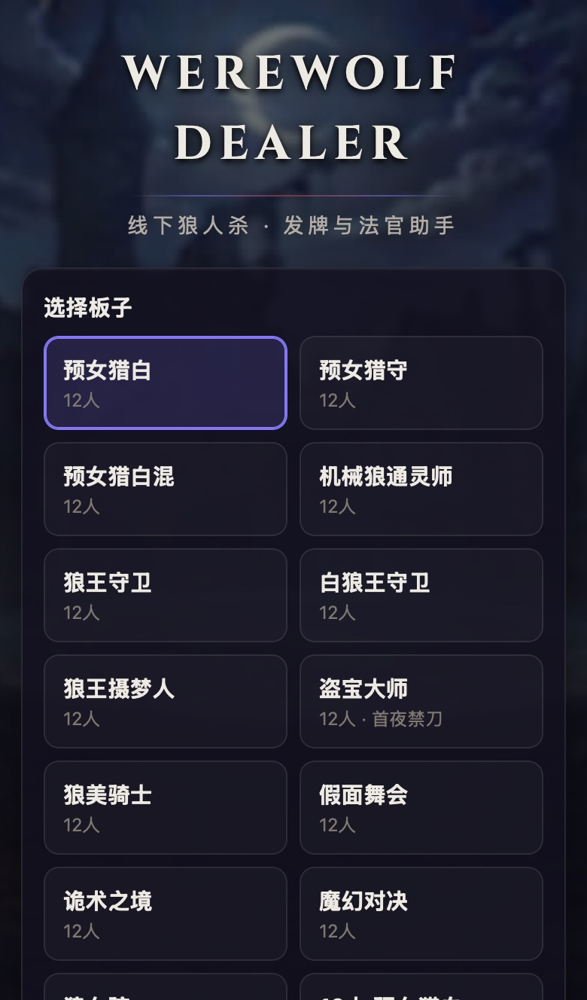
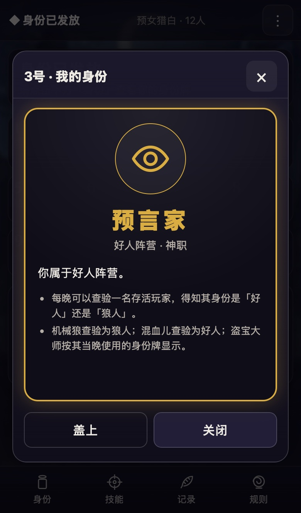
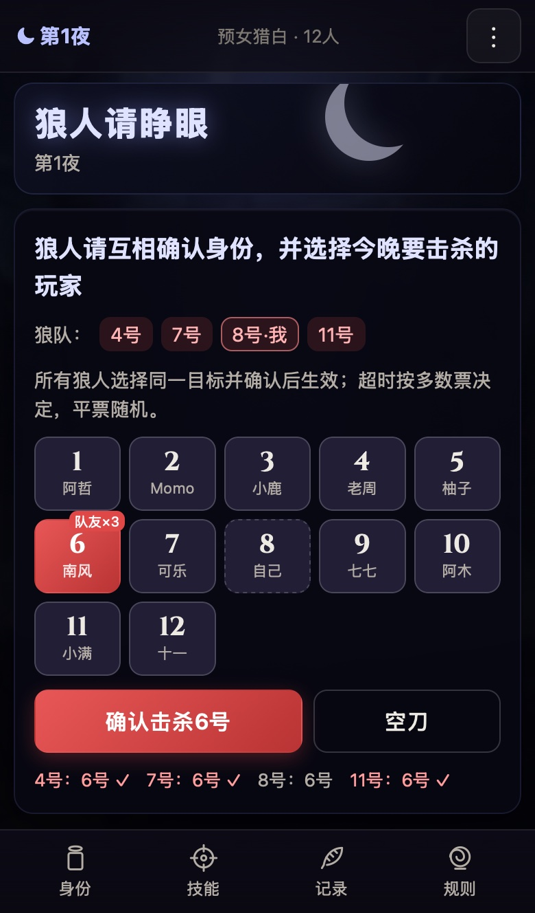
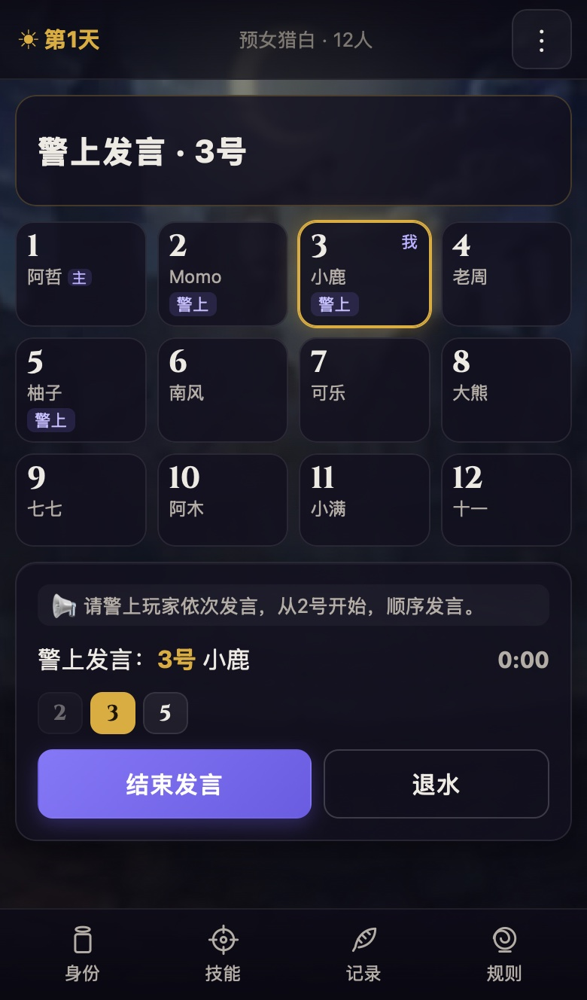
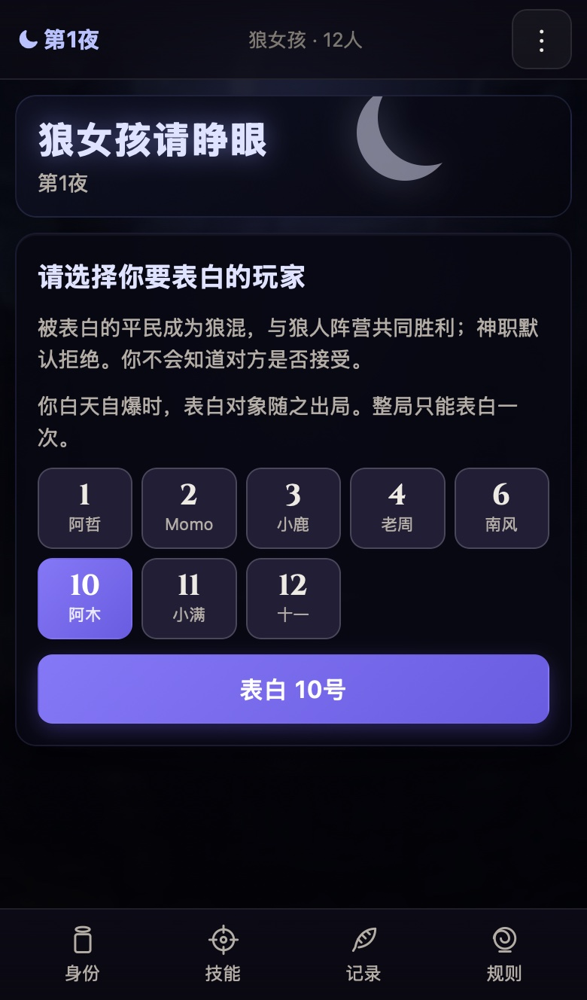
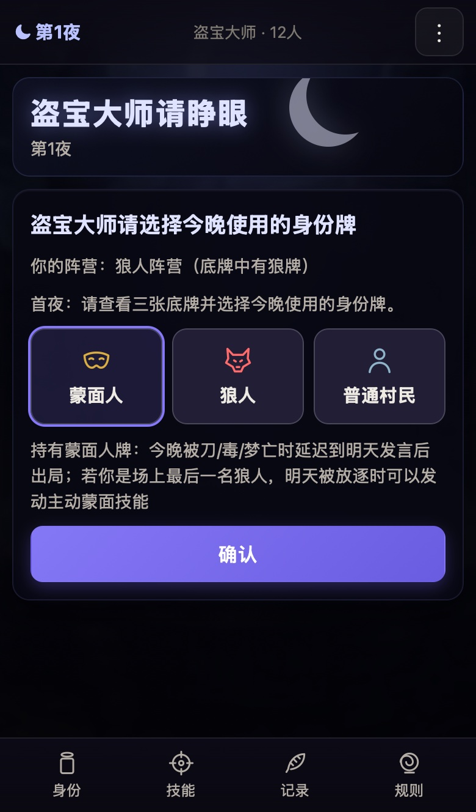

# Werewolf Dealer

A web-based dealer and judge (法官) for **in-person** 狼人杀 games. Everyone opens a link
on their phone, takes a seat and sees their own role card. The server runs the night: it calls each role in
京城大师赛 order, collects actions from phones, settles the night, then manages the sheriff
election, speeches, votes, last words and victory. The owner's phone plays the judge's voice
and a night soundtrack.

The UI is in Chinese and designed for phones (iPhone SE and up, Android, WeChat's built-in browser).
It is self-hosted: run your own instance (one small Docker container, see
[Deploy your own instance](#deploy-your-own-instance)) and share its link with your group.
Short of players, or trying a board alone? [Bots](#playing-with-bots) fill the empty seats.

<table>
  <tr>
    <td align="center"><br><sub>Pick a board or any role mix</sub></td>
    <td align="center"><br><sub>Friends join by link, bots fill the rest</sub></td>
    <td align="center"><br><sub>Your own role card</sub></td>
    <td align="center"><br><sub>Night: the pack agrees on a kill</sub></td>
  </tr>
  <tr>
    <td align="center"><br><sub>Night: 预言家 checks a player</sub></td>
    <td align="center"><br><sub>Day: 警上发言 and 退水</sub></td>
    <td align="center"><br><sub>Exile vote (警长 1.5 票)</sub></td>
    <td align="center"><br><sub>记录: who voted for whom</sub></td>
  </tr>
  <tr>
    <td align="center"><br><sub>Every card revealed at the end</sub></td>
    <td align="center"><br><sub>狼女孩 confesses (首夜禁刀)</sub></td>
    <td align="center"><br><sub>骑士 duels from the 技能 menu</sub></td>
    <td align="center"><br><sub>盗宝大师 picks tonight’s card</sub></td>
  </tr>
</table>

<sub>Screenshots from an iPhone 13-sized browser; `node scripts/screenshots.ts` regenerates them.</sub>

## How a game goes

1. **Create a room** on the home page: pick a board (预女猎白, 预女猎守, 预女猎白混, 机械狼通灵师,
   狼王守卫, 白狼王守卫, 狼王摄梦人, 盗宝大师, 狼美骑士, 假面舞会, 诡术之境, 魔幻对决, 狼女孩, 9/10-person boards)
   or set custom role counts (4–20 players, any mix of roles), optionally adjust the rule options,
   enter your name, tap 创建房间.
2. **Invite**: tap 邀请 → 复制链接 and paste it in the group chat. Anyone with the link joins
   (no accounts; identity is a random id kept in the browser, like when2meet).
3. **Seats**: everyone (including the owner) taps a free seat. Seats are numbered like the table.
   Not enough people? The owner taps **补满空位** and bots take the empty seats (see [Playing with bots](#playing-with-bots)).
4. **发牌** (owner, when all seats are filled) → everyone taps 查看我的身份 (tap the card to flip it).
   The role card can be reopened at any time from 身份 in the bottom bar.
5. **开始游戏**: the night starts. The owner's phone speaks every directive (天黑请闭眼, 狼人请睁眼 …)
   and plays music between them. The called role acts on their phone; everyone else sees 请闭眼.
6. **Day**: 上警 sign-up, 警上发言 (退水 any time), 警下 vote, death announcement, 发动技能 window,
   遗言, the sheriff picks the speaking direction, speeches, exile vote (警长 1.5 票), PK on ties.
   The current speaker taps 结束发言; the owner can always advance with 下一位. A speech (or 遗言) begins
   when the judge has finished asking for it, so 结束发言 / 遗言结束 stays disabled while the voice is still
   playing the lines before it.
7. The result screen shows every role, who won, the buried cards (盗宝大师) and a god's-eye night log.
   The owner can 再来一局 (same seats, new deal) or reconfigure (⋮ → 重新配置并开始).

Anyone can leave a room from the lobby's bottom bar (**退出**) or the menu (**退出房间**). A seated player
gives the seat up in the lobby; during a game the seat and role are kept for when they come back through the
link. The owner keeps ownership and the room stays.

Bottom bar (identical for every role, so a glance at someone's phone reveals nothing):
**身份** (role card), **技能** (hidden menu: 自爆 / 白狼王自爆带人 / 骑士决斗, potions and other private status),
**记录** (public history: deaths, elections, 票型 vote breakdowns, 自爆, shots, badge passes),
**规则** (every role in this game + general rules + night order).

Owner menu (⋮): invite link, an **owner link** for using another device, sound settings (voice,
music, volumes, test), pause/resume, restart with the same config, reconfigure, end the game,
and seat management. Releasing a seat during a game lets that player re-claim it from a new phone,
lets someone else take over, or hands it to a bot. The role stays with the seat.

## Playing with bots

The owner can fill empty seats with bots: tap **补满空位** in the lobby, or use ⋮ → 座位管理 to put a bot on one
chosen seat. This is for trying the app alone, or playing a board with fewer people than seats. Bots
run inside the server, so no extra phones or browser tabs are needed.

- **They see only their own seat.** A bot decides from exactly the view a phone in its seat gets (its card,
  its own checks, its pack), so it cannot cheat and does not leak anything.
- **They handle every routine action.** They look at their card, act at night (knives,
  checks, potions, guards, swaps, dances, 表白 …), sometimes run for sheriff, vote, and use 开枪 / 警徽 /
  蒙面 when they die. They end their own speeches after a few seconds and wait for the judge's voice to
  finish before acting.
- **They play simply.** Bot wolves agree on one knife, follow a human teammate's pick, and mostly vote
  together. Good bots vote for wolves they know about (their own 预言家 / 通灵师 checks, revealed cards) and
  otherwise follow a shared hunch. Bots never 自爆 or 决斗 on their own, and they cannot talk, so a
  bot 预言家 never shares what it found. With mostly bots at the table, the wolves usually win.
- **People take priority.** In the lobby, tapping a bot's seat takes it over, and **全部移除** clears every
  bot. During a game, the owner can hand any seat to a bot (⋮ → 座位管理 → 释放, then 机器人接管). The reverse
  also works: release a bot's seat and a person claims it. Either way the newcomer keeps that seat's card
  and what it learned so far.
- To watch a game played only by bots, the owner leaves their seat (离开座位) and then fills every seat with bots
  before dealing. The owner's phone still plays the judge's voice.

## Secrecy by design

- Each phone receives only its own private view (`server/rooms.ts` builds per-client views). Other
  roles never reach the browser, not even in the WebSocket traffic.
- Every role configured for the board is called every night, even when that player is dead
  or the card is buried. Dead/absent steps wait a random 6–13 s, and live players must wait at
  least 4 s, so step timing does not reveal who is alive.
- Night countdowns are only sent to the acting player (a public countdown would reveal that the
  called role is alive).
- Spoken lines never contain private information (the witch hears the same line whatever happened).
- Night deaths stay hidden — even from the victim — until the judge announces them, which on day 1
  happens after the sheriff election (night-1 victims can still run for sheriff and vote).
- The skill menu and the "确认是否发动技能" screen look the same for every role until opened.

## Rules (京城大师赛)

The rules follow 京城大师赛 conventions. Where public sources disagreed or said nothing, these are the
choices made. Most are summarised in the in-game 规则 panel. The ones marked *option* can be
changed per room.

General
- 屠边: wolves win when all 神 or all 民 are out; good wins when all wolf-faction players are out.
  The game ends the moment a condition is met (the last god's hunter shot never happens).
  *Option*: when both sides meet their condition through the same event, the default is 狼人胜利
  (no source settled this; alternatives: 好人胜利 / 平局).
- 警长竞选 on day 1 before the death announcement: simultaneous 上警 sign-up, random speaking start
  and direction, 退水 allowed during speeches (退水 players lose the sheriff vote), only one candidate
  left → elected, nobody/no votes → 警徽流失, tie → PK speeches + revote → tie → 警徽流失.
- 警长: 1.5 votes in exile votes, chooses 顺序/逆序 (starting next to the sheriff), speaks last,
  passes or tears the badge on death (also when self-destructing).
- 自爆 during speech phases only (警上发言, 退水, PK, 放逐发言). No last words. The day ends
  (night deaths are still announced first). *Option*: **双爆吞警徽** (default: the first 自爆 during the
  election postpones it to the next day, resuming at the 退水 stage; the second loses the badge) or 单爆吞警徽.
- 遗言: night-1 deaths, exiled players, players shot during the day. Not: later night deaths,
  自爆, players taken by 白狼王.
- Exile: everyone alive votes (abstaining allowed, voting for yourself not), most votes out,
  tie → PK + revote among the rest → tie → nobody out; no votes at all → nobody out.
- *Option*: 女巫自救 (default never), 梦游者免疫毒药 (default yes, as in 京城),
  time limits for night actions, the wolf pack, votes and sign-up.

Roles (full text in `shared/roles.ts`)
- 女巫: one antidote + one poison, never both in one night, cannot self-save, stops seeing the
  knife once the antidote is used. 同守同救 (guard + antidote on the same player) kills.
- 守卫: may guard self or nobody, never the same player two nights running, does not stop poison.
- 猎人 / 狼王: shoot only when knifed or exiled (not when poisoned, 梦亡, shot, taken, or 自爆).
  Both are told their status every night.
- 白神: no skill. Exiled → "x号玩家出局，翻牌为白神（请留遗言）". No flip at night.
- 毒师: one poison, any night.
- 摄梦人: must pick another player every night. The sleepwalker is immune to the knife and poison. The same
  player two nights running dies (梦亡), and the dreamer dying at night takes the sleepwalker along.
- 乌鸦: must curse someone (not the same player twice running). The curse is +1 vote in the next day's
  exile votes, so it can exile on its own when everyone abstains.
- 混血儿: picks a 榜样 on night 1, wins with the 榜样's faction, counts as 民, seer sees 好人.
- 白狼王: 自爆 and may take one player. A 白狼王 poisoned at night who self-destructs before the
  announcement (吞毒自爆) cannot take anyone, and his poison death is then not announced.
- 机械狼: never meets the pack, cannot self-destruct, learns one player on night 1 (may skip) and
  sees their role. Skills work from night 2: 预言家/通灵师 → nightly check; 女巫/毒师 → one poison
  (机械女巫只有一瓶毒药); 守卫 → 机械守卫: a nightly guard that stops the knife and **bounces poison**
  (弹毒, "机械守卫可守护并反弹女巫毒药"): a poison aimed at the guarded player never reaches them and kills
  whoever used it instead (the 毒师's and a 盗宝大师 poison card bounce too, a custom-table judgement call; a
  sleepwalker is still immune). 弹毒 works once per game; afterwards the guard only stops the knife. Never the
  same player two nights running; 猎人 → shoots when knifed or exiled
  (按猎人开枪处理); any wolf → 双刀 (two kills, the second ignoring guards) on the first night after the
  pack is gone, otherwise lost; anyone else (平民, 白神 …) → no skill. Gets the knife when all pack wolves
  are out. Unlearned, the 通灵师 sees "机械狼"; learned, the learned role.
- 蒙面人 (京城大师赛 replaced 乌鸦 with it on the 盗宝大师 board): knifed, poisoned or 梦亡 at night
  → 中毒/负伤 instead of dying. It is left out of the dawn death announcement and goes out right after its
  own discussion speech the next day (that speech is its last words). If the day ends before it
  speaks (e.g. a 自爆), it goes out before night falls. The antidote, the guard and dream immunity still
  protect it, and 同守同救 wounds it. If its death means 屠神 and two or more wolves remain, the game is
  settled at dawn (the board designer's ruling). A wounded sheriff speaks last, goes out, and passes
  the badge before the vote. The player sees their wound only inside 身份/技能.
- 盗宝大师 (15 cards for 12 seats; 通灵师 毒师 猎人 摄梦人 蒙面人 + 狼王 3狼 + 5民; 首夜禁刀: nobody kills on
  night 1, "本版型首夜狼人无法发动击杀技能"): three buried cards, always one god, one villager and one
  普通狼人, so it is always 盗宝狼: wolf faction, never meets the pack, gets the knife after its teammates
  (the pack can tell from its own size). Custom tables with 盗宝大师 need at least one god, one villager and
  one pack wolf in the pool to bury. Each night it uses one card, never the same one
  twice in a row. God cards give that night's skill (the 女巫 card has only a poison), wolf and villager
  cards are camouflage, and so are cards without a simple night skill on custom tables (白神, 骑士, 舞者,
  魔术师, 定序王子; a buried role is still called every night). Holding the 猎人 card it may shoot on death; holding the 蒙面人 card it has the
  蒙面 passive. Using the 摄梦人 card on the same player on two successive uses (one night apart) kills
  them (盗宝摄梦隔夜梦亡). As the last wolf holding the 蒙面人 card, if exiled it may survive once and
  kills twice that night (主动蒙面). The 通灵师 sees the card; the 预言家 sees the card's faction.
- Wolves: every living pack wolf must confirm the same target (or 空刀); on timeout the most-picked
  target wins, ties broken at random. Self-knife is allowed.

Roles of 狼美骑士, 假面舞会, 诡术之境, 魔幻对决 and 狼女孩 (each also works in custom games of any size)
- 骑士: flips and duels one living player during 放逐发言 or 放逐PK发言 only (not the election, last
  words or the 定序王子's speech), once per game, from 技能. Wolf-faction target (any wolf card incl.
  狼美人, 假面, 机械狼, 盗宝狼) → it goes out without last words and night falls at once (no exile vote;
  a wounded 蒙面人 still goes out first). Good target → the knight goes out, leaves last words, and the
  speeches continue where they were. A duelled 狼王 cannot shoot.
- 机械狼 learning any wolf-faction card (incl. 狼美人, 诡术师, 狼术师, 假面) gets the 双刀; the new god cards
  give it nothing.
- 狼美人: knifes with the pack (the pack cannot knife her), then charms one other player alone, never the
  same player two nights running; the charm stays on the last target if she skips a night. Exiled or
  poisoned (witch, 毒师, any poison) → the charmed player dies too (殉情: no last words, no gun).
  Duelled, shot or taken → no 殉情. Cannot self-destruct. If she is the last wolf and her 殉情 takes the
  last god or villager, the wolves win, whatever the tie option says (as her card states).
- 舞者: from night 2 picks exactly three players for the dance floor (self allowed), each player at most once
  per game, or skips. At dawn a mixed floor loses its minority (2 vs 1 → the 1 dies, cause 舞池). Nothing
  blocks it (antidote, guard, dream), and a hunter dying there cannot shoot. With the dancer on the floor
  the floor is immune to the knife that night. The dancer is immune to the witch's poison.
- 假面: wolf faction, never meets the pack, cannot self-destruct, immune to the witch's poison. Night 1 it only
  confirms its card. From night 2: first verifies one player (is X on the floor tonight?), then may give a
  mask (not to the same player two nights running): the masked player counts as the opposite faction on the
  floor tonight. Gets the knife when the pack is gone (on a custom table without a pack, from night 1).
- 魔术师 / 诡术师 / 狼术师 (number swaps): every skill aimed at one of two swapped numbers that night hits the
  other player instead: knife, poison, antidote, guard, checks, dance picks, mask, charm. Swaps compose in
  call order 魔术师 → 诡术师 → 狼术师, so the same pair swapped twice cancels out. The witch sees the knife as
  the number the wolves picked. Her antidote is void if, through the swaps, it would land on herself
  (no self-save). Each number can be swapped by the 魔术师 once per game; each player by the 诡术师 once,
  and the 诡术师 may not skip two nights running. 狼术师 acts from night 2. *Option* (默认开): 魔术师首夜可交换;
  the 魔幻对决 preset turns it off. 诡术师's "白天出局信息置换" has no reliable source, so swaps
  only affect the night.
- 狼女孩 (board 狼女孩: 预言家 毒师 猎人 守卫 + 狼女孩 3狼 + 4民): wakes with the pack. On night 1 the pack
  only confirms each other (*option* 首夜禁刀, on for this board; it also stops 假面/盗宝狼 knives that
  night). Then she confesses (表白) to one player outside her pack: mandatory, night 1 only, random on
  timeout. A plain 平民 becomes 狼混: same card, checks as 好人, counts as 民 for 屠边, wins with the
  wolves, and does not meet them. Good still wins once every real wolf is out, 狼混 alive or not.
  Anyone else (gods, 混血儿, 盗宝大师 …) refuses by default and keeps everything. Right after her step only
  the confessed player is told (被表白的玩家请睁眼), without learning who she is; she never learns the
  answer. When she self-destructs, the confessed player goes out with her if still alive, even if killed
  at night but not yet announced. Neither leaves last words, a hunter cannot shoot, a guard cannot stop it,
  and a sheriff passes the badge. Exiled, poisoned, shot or duelled → nothing happens to the confessed
  player. Swaps redirect the confession like any targeted skill.
- 定序王子: after every exile vote with a result (not the election, not a 平票), a fixed 10 s window
  opens. It opens even when the prince is dead or his card is buried, so it reveals nothing, until the
  skill is spent. If a PK candidate dies during the PK (a lost duel), the other one is the result,
  and the window still opens. Flip → the exile is void, the prince speaks once (no 自爆 or duels during
  it), then everyone alive votes again. Once per game; he may void his own exile.

Night order: 魔术师 → 诡术师 → 狼术师 (night 2+) → 混血儿 (night 1) → 机械狼学习 (night 1) → 盗宝大师 →
舞者 (night 2+) → 假面 → 摄梦人 → 守卫 → 狼人 → 狼美人 → 狼女孩 + 被表白者 (night 1) → 机械狼刀人 → 女巫 →
毒师 → 预言家 → 通灵师 → 乌鸦 → 机械狼技能 → 猎人 / 狼王 / 白狼王 status → 蒙面人 (night 1) → 白神 (night 1).
Settlement happens at dawn, so the order only affects what each role knows. Swaps come first because they
redirect everything after them. Guards and dreamers act before the knife, the witch after it, and status
checks after every poison.

Sources consulted: the 京城大师赛 official Weibo post introducing 蒙面人 (2024-10-28) and the board
designer's clarification of its execution (2025-11-26), 京城大师赛 超话 rule notes on 盗宝大师,
tournament-style setup write-ups for 京城-style boards (melbournemasters.org setups, werewolves.games
judge scripts), and community rule summaries (Douban, Gamersky, 口袋狼人杀). 狼女孩 follows a community write-up
of the 12-person 狼女孩 board (表白、狼混、首夜禁刀、自爆报复、屠边). Where it was silent (night 1 only, mandatory,
not to her pack, 狼混 counts as 民), the choices are listed above. There is no single official 京城 rulebook online. If a
ruling differs from how you play, it is easy to change: settlement is in `server/game/resolve.ts`, the
flow in `server/game/engine.ts`.

## Audio

- Judge lines are pre-generated mp3 clips (`client/public/audio`, ~1.5 MB, Microsoft neural voice
  `zh-CN-YunyangNeural` via edge-tts). Announcements with numbers are composed from clips
  ("3号" + "玩家自爆"). If a clip cannot load, the browser's own speech synthesis reads the text.
- Night music: if the instance has a recorded track at `client/public/music/night.mp3`, the owner's phone
  plays it, looping with an 8-second crossfade. Otherwise a soundtrack is generated live with Web Audio
  (`client/src/audio/music.ts`: drone, wind, minor pads, bells, heartbeat). That one is original, so there
  are no licensing issues. Either way the music ducks under the judge's voice and fades out at dawn.
- To use your own night music, for example one made with an AI music service, prepare it with
  `node scripts/prep_music.ts <your track>`. The script trims the silence at both ends, matches the loudness
  of the built-in soundtrack (-20 LUFS, one linear gain, so the track's dynamics are kept) and writes
  `client/public/music/night.mp3`. That folder is git-ignored, so the track stays yours, and `deploy/deploy.sh`
  copies it to your server. The owner's phone starts downloading it (3–4 MB) at the first tap in the room;
  if a night begins before it is ready, the synthesized soundtrack plays and crossfades to the track when it arrives.
- Only owner devices play sound (toggle 🔊 in the top bar). Phones require a tap before audio can
  start; a banner asks for it.
- iPhones in silent mode: iOS mutes Web Audio with the ring/silent switch. The owner's phone asks for the
  "playback" audio session and also keeps a looping, silent `<audio>` element playing (the technique of the
  `unmute` library), which puts the page on the media channel the switch does not mute. The element stops when
  the page goes to the background (so no media controls are left on the lock screen) and restarts on the next tap.
- Sound cut off mid-game (a call, Siri, a notification sound, the screen locking, switching apps): iOS can hand the
  page back an audio engine that stays silent even though it claims to run, which used to need a reload. The
  owner's phone notices when the system pauses or interrupts it, when its clock stops while something should be
  playing, and (on iPhones) when the page was in the background. The banner then reads 声音被系统打断了，点此恢复,
  and the next tap builds a fresh engine, the way a reload would. The game stays on screen, the loaded clips are
  kept, the night music starts again and the latest judge line is repeated if it is still fresh. The screen wake
  lock is requested again whenever the system drops it.
- ⋮ → 本机声音 → **测试声音** says when a setting keeps the phone quiet (本机播放声音, 法官语音, 语音音量), and
  **声音诊断** lists what the sound on this phone is doing: browser, audio engine state and sample rate, audio
  session, clips loaded and played, night music, and the last problem it ran into.
- All phones keep the screen awake during a game (Wake Lock API, with a muted-video fallback).

## Development

Requirements: Node ≥ 22.18 (runs the TypeScript server directly), npm. Optional: Python 3 + ffmpeg
for regenerating audio.

```bash
npm install
npm run dev            # server on :3000 (node --watch) + Vite on :5173 (proxies /api and /ws)
npm test               # engine + server tests (vitest)
npm run typecheck
npm run build          # client → dist/client
npm start              # production server; serves dist/client
npx playwright install webkit chromium   # once
npm run test:e2e       # full games in iPhone 13 / iPhone SE / Pixel 7 browsers
```

Regenerate the README screenshots (plays scripted games against a local server, writes `docs/screenshots/`):

```bash
npm run build && node scripts/screenshots.ts                # all scenes
npm run build && node scripts/screenshots.ts lobby knight   # only some: main, lobby, wolfgirl, knight, treasure
```

Regenerate voice clips after editing `shared/audio.ts`:

```bash
python3 -m venv scripts/.venv && scripts/.venv/bin/pip install edge-tts
scripts/.venv/bin/python scripts/gen_audio.py            # only missing clips
scripts/.venv/bin/python scripts/gen_audio.py --force    # all clips
```

Server environment: `PORT` (3000), `HOST`, `DATA_DIR` (room snapshots, default `./data`),
`STATIC_DIR` (default `dist/client`), `TRUST_PROXY=1` behind a reverse proxy, `CREATE_LIMIT` (new rooms per
hour per IP, default 30), and test-only `TIME_SCALE`
(speeds up every timer) and `TEST_HOOKS=1` (fixed-role deals).

## Tests

- `tests/engine/resolve.test.ts`: the night settlement matrix (同守同救, 破盾刀, dream immunity, 梦亡,
  机械守卫 弹毒 …).
- `tests/engine/flow.test.ts`: whole days and nights: election edge cases, 退水, PK, 双爆/单爆,
  吞毒自爆, 白狼王, witch/guard/hunter rules, 1.5 sheriff votes, curses, 白神, 屠边 and ties.
- `tests/engine/special.test.ts`: 机械狼, 盗宝大师, dealing balance, timing secrecy, and that night prompts and audio
  never leak private information.
- `tests/engine/masked.test.ts`: 蒙面人 wounds (knife/poison/梦亡, antidote/guard/同守同救), going out after its
  own speech or before nightfall, early settlement, the wounded sheriff, 盗宝蒙面 survival + double knife,
  盗宝摄梦隔夜梦亡.
- `tests/engine/newroles.test.ts`: 骑士 duels (wolf/good target, timing windows, PK, badge, 蒙面人), 狼美人 charm
  and 殉情 (poison vs exile vs duel, last-wolf tie), the dance floor (minorities, masks, knife immunity, poison
  immunity, unblockable deaths), swaps composing with each other and with every targeted skill (witch,
  guard, seer, dreamer, 机械狼 …), 定序王子 windows (dead or buried prince), 狼女孩 (首夜禁刀, 狼混 wins and
  secrecy, refusals, 自爆报复 incl. election/sheriff/unannounced deaths, swaps), the new roles with 机械狼 and
  盗宝大师, and the night orders.
- `tests/engine/boards.test.ts`: scripted complete 12-player games on 预女猎白混, 机械狼通灵师 and 盗宝大师
  (two buried-card variants), checking the table after every night and day.
- `tests/engine/fuzz.test.ts`: random agents play ~5,900 complete games: every preset; 400 more each on
  预女猎白混 / 机械狼通灵师 / 盗宝大师 / 狼美骑士 / 假面舞会 / 诡术之境 / 魔幻对决 / 狼女孩 (asserting their key
  mechanics actually happen); 200 from a last-wolf 盗宝蒙面 position; and 1,500 random custom tables (5–18
  players, any mix of roles and rule options). They act only through the prompts the UI uses; every
  prompt-derived action must be accepted, every game must end, and nothing the judge says at night may
  contain a seat number.
- `tests/server/server.test.ts`: real WebSocket clients play a full game; per-client privacy,
  reconnect, owner permissions, seat release/re-claim, owner link, restart persistence, origin check, the
  search-engine opt-out (robots.txt, noindex, crawlers refused by user agent) and an owner playing a seat among bots.
- `tests/server/bots.test.ts`: bot decisions on hand-made views (only their own turn, never a teammate,
  following a human wolf, seer checks, potions, mandatory skills, 盗宝大师, death skills), seating and takeovers
  in the lobby and mid-game, a person among bots, pause, restart persistence, waiting for the judge's
  voice, and all-bot games on a fake clock: every preset plus 150 random custom tables, each played to the end
  with no rejected bot action.
- `tests/e2e/game.spec.ts`: Playwright on phone profiles: three browser players (owner/预言家, 女巫,
  狼人) plus scripted WebSocket players (`tests/e2e/bots.ts`) play a full game through the real UI,
  asserting no horizontal overflow and no console errors; screenshots go to `test-results/shots/`.
- `tests/e2e/boards.spec.ts`: the special roles of 预女猎白混 (混血儿, 白神), 机械狼通灵师 (机械狼, 通灵师) and
  盗宝大师 (盗宝大师 card choice, wounded 蒙面人) driven through the UI, each game played to the end.
- `tests/e2e/newboards.spec.ts`: 狼美骑士 (charm, a duel from the 技能 menu), 假面舞会 (three dancers, 假面 verify +
  mask), 诡术之境 (a 魔术师 swap moving the knife, the 定序王子 voiding an exile), 魔幻对决 (a 狼术师 swap) and
  狼女孩 (首夜禁刀, confession, 自爆报复) through the UI, each game played to the end.
- `tests/e2e/solo.spec.ts`: the owner fills the table with bots from the lobby (and adds or removes single
  bots in the owner menu), then plays a whole game as 预言家 among them.
- `tests/e2e/sound.spec.ts`: on iPhones the silent media channel opens on a tap, closes in the background and
  reopens on the next tap (other phones never load it); 测试声音 explains a switched-off setting; 声音诊断; sound
  cut off mid-game (a suspended engine, an iPhone page back from the background) comes back with one tap on a
  freshly built engine.
- `tests/e2e/lobby.spec.ts`: 退出 from the lobby frees the player's seat; the owner leaves and comes back as owner.
- `tests/e2e/music.spec.ts`: at night the owner's phone plays the recorded track if the instance has one,
  the synthesized soundtrack if not (or until a slow download arrives, then crossfades), and the music switch
  in the menu stops and restarts it.

## Deploy your own instance

Werewolf Dealer is one small container (`Dockerfile`: Node 24 alpine, ~60 MB RAM, no database).
Rooms are kept in memory and snapshotted to a Docker volume, so they survive restarts and
redeploys; idle rooms are removed after 48 h. You need a Linux host with Docker (Compose v2),
a domain pointing at it, and a reverse proxy that terminates HTTPS. HTTPS is required:
phones only allow screen wake lock and clipboard access on secure origins, and the proxy must
forward WebSocket upgrades on `/ws`.

**1. Run the container** on the host:

```bash
git clone https://github.com/caizefeng/werewolf-dealer.git && cd werewolf-dealer
docker compose up -d --build        # serves 127.0.0.1:3232 (set HOST_PORT to change it)
curl http://127.0.0.1:3232/api/health
```

**2. Put HTTPS in front of it.** With [Caddy](https://caddyserver.com) (automatic certificates,
WebSockets work out of the box), add a site block (template: `deploy/werewolf.caddy.template`):

```caddy
werewolf.example.com {
	encode zstd gzip
	reverse_proxy 127.0.0.1:3232
}
```

With nginx, proxy to the same port and forward the upgrade headers:

```nginx
location / {
    proxy_pass http://127.0.0.1:3232;
    proxy_http_version 1.1;
    proxy_set_header Upgrade $http_upgrade;
    proxy_set_header Connection "upgrade";
    proxy_set_header Host $host;
    proxy_set_header X-Forwarded-For $proxy_add_x_forwarded_for;
}
```

The compose file sets `TRUST_PROXY=1` (client IPs from `X-Forwarded-For`, used for rate limits);
keep the published port bound to `127.0.0.1` so only the proxy can reach it.

**Or deploy from your machine** with the helper script. It syncs the sources over SSH, rebuilds the
container, renders and validates a Caddy site file (for a Caddy whose main Caddyfile imports a
directory such as `/etc/caddy/sites/*.caddy`), reloads Caddy and checks the health endpoint:

```bash
cp deploy/deploy.env.example deploy/deploy.env   # git-ignored: your host, directory, domain, port
deploy/deploy.sh
node scripts/smoke.ts ynlbh https://werewolf.example.com   # optional: 12 bots play night 1 on it
```

Logs: `docker logs -f werewolf-dealer` on the host. Health: `GET /api/health`.

**Kept out of search engines.** An instance is meant for one group's chat, so it stays out of search engines,
archives and AI training sets:

- `/robots.txt` disallows everything.
- Every response carries `X-Robots-Tag: noindex, nofollow, noarchive, nosnippet, noimageindex`, and the page has the
  same `robots` meta tag.
- Crawlers that identify themselves (search engines, SEO tools, AI crawlers such as GPTBot, ClaudeBot or CCBot,
  web archives) get `403` everywhere except `/robots.txt` and `/api/health`.

Phones and the link previews of chat apps (Telegram, WhatsApp, Discord, Slack, iMessage …) are not affected. A
scraper that pretends to be a browser can still load the app itself, but there is nothing to find: games live
behind random room links that expire after 48 hours idle.

**Capacity.** A small VPS is plenty. Measured with `scripts/loadtest.ts` against an instance on a 1 vCPU / 1 GB
VPS behind Caddy (HTTPS), with simulated phones that load the page, play at human speed with
8-second speeches and drop and reconnect after screen locks. The server's own share of each WebSocket round trip
was about 10 ms at the median and at most about 40 ms at p95; the rest of the table's times are network distance (66 ms when idle).

| Load | Server CPU (app + Caddy) | App memory | WebSocket round trip p50 / p95 | Action answered (p95) | Errors |
| --- | --- | --- | --- | --- | --- |
| 4 rooms, 48 phones | 1% + <1% average | 58 MB | 75 / 91 ms | 84 ms | 0 |
| 10 rooms, 120 phones | 2% + 1% average | 59 MB | 74 / 97 ms | 82 ms | 0 |
| 20 rooms, 240 phones + 5 rooms of bots | 4% + 1% average, 15% peak | 72 MB peak | 77 / 108 ms | 82 ms | 0 |

Restarting the container in the middle of 10 games (as a redeploy does) took about 2 s. Every phone
reconnected on its own within a few seconds, and the games went on where they were. At the busiest load,
WebSocket traffic averaged about 3.5 Mbit/s, because every update carries the player's whole view, about 5–9 KB.
To try your own instance:

```bash
node scripts/loadtest.ts https://werewolf.example.com --rooms 10 --minutes 8   # 10 rooms of 12 simulated phones
node scripts/loadtest.ts https://werewolf.example.com --cleanup                 # afterwards: end the test games
```

An instance accepts at most 30 new rooms per hour from one IP, so the load test keeps its rooms in a file and reuses them.

## License & credits

MIT © Zefeng Cai (see `LICENSE`).

- Background art and wolf favicons come from [werewolf-viewer](https://github.com/caizefeng/werewolf-viewer).
- Title font: Cinzel, SIL Open Font License 1.1 (`client/public/fonts/OFL-Cinzel.txt`).
- Judge voice clips are generated with Microsoft's `zh-CN-YunyangNeural` neural voice via edge-tts.
- The repository contains no recorded music: without a track of your own, the night soundtrack is
  synthesized live in the browser.
